# torchbelief in pictures

A beginner's walkthrough. You don't need to know any belief-function theory, only a little
PyTorch. Every picture below is computed by the library itself
([`docs/make_figures.py`](make_figures.py)), and every code snippet runs as written. Snippets
build on the setup in section 1.

**Contents:** [the big picture](#0-the-big-picture) ·
[two numbers instead of one](#1-two-numbers-instead-of-one) ·
[how the data is stored](#2-how-the-data-is-stored) ·
[combining sources](#3-combining-sources-where-does-the-conflict-go) ·
[finding the culprit](#4-finding-the-culprit) ·
[deciding or abstaining](#5-deciding--or-admitting-you-cant) ·
[neural networks that say "I don't know"](#6-neural-networks-that-say-i-dont-know) ·
[numbers instead of classes](#7-numbers-instead-of-classes-p-boxes) ·
[seeing contradictions](#8-seeing-contradictions-belnaps-four-values) ·
[real video](#9-real-video-labels-that-dont-flicker) ·
[trusting a source only so far](#10-trusting-a-source-only-so-far) ·
[answering with a set](#11-answering-with-a-set) ·
[glossary](#glossary)

---

## 0. The big picture

<picture>
  <source media="(prefers-color-scheme: dark)" srcset="figures/pipeline-dark.svg">
  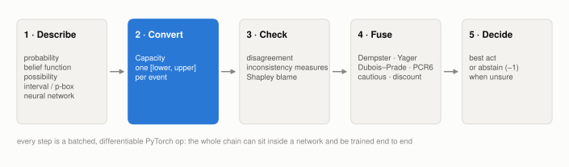
</picture>

Imagine several sensors, models or experts, each telling you something about the same question:
*is it a car, a truck or a bike?* Some are precise, some are vague, and some are wrong.
torchbelief turns each statement into the same kind of object, checks whether the sources
contradict each other and who is responsible, fuses them, and then either picks an answer or
**abstains** when the evidence doesn't support one.

Every step is an ordinary PyTorch operation. It works on batches, runs on GPU, and you can
backpropagate through all of it.

## 1. Two numbers instead of one

<picture>
  <source media="(prefers-color-scheme: dark)" srcset="figures/intervals-dark.svg">
  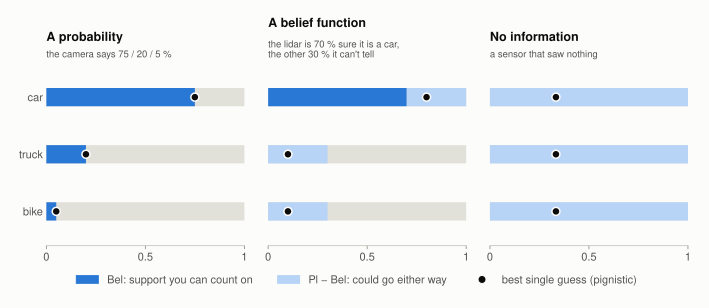
</picture>

A probability says "car: 75 %". A belief function says **"car: at least 70 %, at most 100 %"**.

- **Belief (Bel)**, the dark part, is the support you can count on.
- **Plausibility (Pl)**, the end of the light part, is how high it could go if all the undecided evidence went this way.
- The **gap** between them is honest ignorance. A probability has no gap. A sensor that saw nothing has the widest possible gap, `[0, 1]` for everything.

The black dot is the best single guess (the *pignistic* probability). It's there for when you
need one number, but the interval is the real answer.

```python
import torch, torchbelief as tb

F = tb.Frame(3, names=["car", "truck", "bike"])          # the possible answers

camera = tb.Capacity.from_probability(torch.tensor([0.75, 0.20, 0.05]), F)
lidar  = tb.Capacity.from_mass(tb.simple_support(F, F.subset(["car"]), 0.7), F)  # 70 % car, 30 % unsure
blind  = tb.Capacity.vacuous(F)                                                   # knows nothing

bel, pl = lidar.expectation_bounds(torch.eye(3))   # [Bel, Pl] of each class
print(bel, pl)                                     # tensor([0.7, 0., 0.]) tensor([1.0, 0.3, 0.3])
print(lidar.pignistic())                           # best single guess: tensor([0.8, 0.1, 0.1])
```

A probability, a belief function, a possibility distribution (`from_possibility`) and a set
of probabilities (`from_credal`) all become the same thing, a **`Capacity`**, so everything
that follows works on any of them.

## 2. How the data is stored

<picture>
  <source media="(prefers-color-scheme: dark)" srcset="figures/powerset-dark.svg">
  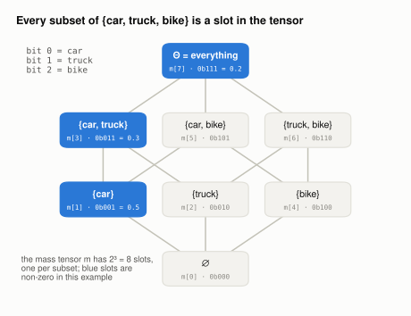
</picture>

Evidence can point at **groups** of answers: "it's a car or a truck" is useful information
even if you can't say which. So instead of 3 numbers (one per class), a *mass function*
stores one number for every **subset** of the classes: 2³ = 8 numbers for 3 classes.

The index of each subset is its **bitmask**. Bit 0 is car, bit 1 is truck, bit 2 is bike, so
`{car, bike}` = `0b101` = index 5. Index 0 is the empty set ∅ ("none of them", which is where
conflict ends up), and the last index is Θ, "any of them", which means *I don't know*.

```python
m = torch.zeros(F.size)                 # F.size == 8
m[F.subset(["car"])] = 0.5              # index 1
m[F.subset(["car", "truck"])] = 0.3     # index 3: "car or truck, can't tell which"
m[F.theta] = 0.2                        # index 7: "no idea"
print(F.elements(5))                    # ['car', 'bike']
print(tb.belief(m, F), tb.plausibility(m, F))   # Bel and Pl of all 8 subsets at once
```

To read a single mass function, print it as a table:

```python
from torchbelief import display

print(display.to_string(m, F))     # also display.to_html and display.to_latex
# set                m     Bel      Pl       Q
# {car}          0.500   0.500   1.000   1.000  ████████████████
# {car, truck}   0.300   0.800   1.000   0.500  ██████████
# Θ              0.200   1.000   1.000   0.200  ██████
```

Because the layout is a dense tensor, adding a batch dimension (`m` of shape `(batch, 8)`)
just works. Dense storage is limited to 16 classes; for bigger frames use `tb.SparseMass`
(up to 62 classes), which stores only the non-zero subsets.

## 3. Combining sources: where does the conflict go?

<picture>
  <source media="(prefers-color-scheme: dark)" srcset="figures/rules-dark.svg">
  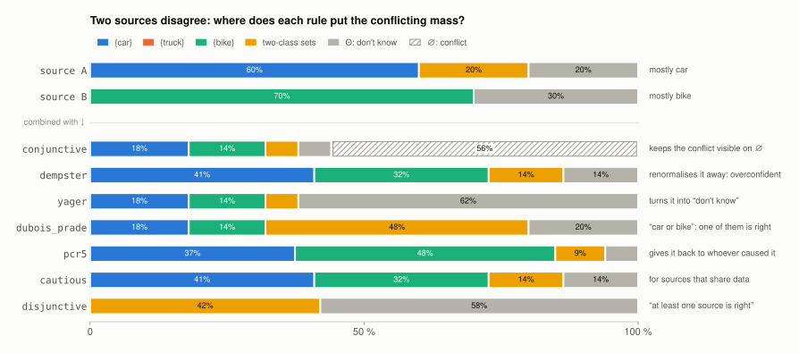
</picture>

Source A thinks *car*, source B thinks *bike*. Multiply their evidence together and 56 % of the
mass lands on ∅, the combinations that can't both be true. **What to do with that conflict is
the whole difference between the rules:**

| Rule | In plain words | Good when |
|---|---|---|
| `conjunctive` | leave it on ∅ so you can see it | you want to measure conflict |
| `dempster` | pretend it never happened and rescale | sources are reliable and agree. Here it confidently says *car*, which is the classic failure |
| `yager` | turn it into "don't know" | conflict should make you less sure |
| `dubois_prade` | "car **or** bike": one of them is right | you trust that someone is right |
| `pcr5` / `pcr6` | hand it back to the sources that caused it | you want a compromise |
| `cautious` | don't double-count shared evidence | sources saw the same data |
| `disjunctive` | "at least one source is right" | sources may be unreliable |

```python
a = torch.zeros(8); a[1] = 0.6; a[3] = 0.2; a[7] = 0.2   # mostly car
b = torch.zeros(8); b[4] = 0.7; b[7] = 0.3               # mostly bike

print(tb.conflict(a, b, F))                 # 0.56
fused, k = tb.yager(a, b, F)                # or dempster, dubois_prade, pcr5, cautious ...
fused, k = tb.combine([a, b], F, rule="pcr6")   # many sources at once
```

## 4. Finding the culprit

<picture>
  <source media="(prefers-color-scheme: dark)" srcset="figures/blame-dark.svg">
  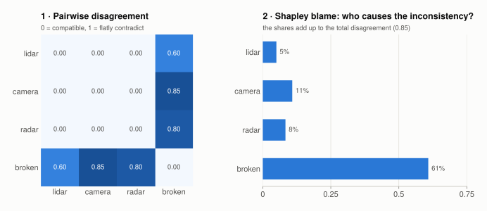
</picture>

Before fusing, ask *do these sources even agree?* `disagreement` is 0 when two sources are
compatible (some probability satisfies both) and 1 when they flatly contradict each other.
With four sensors, one broken, the heatmap shows the pattern immediately.

**Shapley blame** turns that into one number per source. It borrows the fair-division rule
from game theory: how much does the total inconsistency grow, on average, when this source
joins? The broken sensor takes 61 % of the blame. You can then trust each source in proportion,
which is called *discounting*:

```python
from torchbelief import inconsistency as I

radar  = tb.Capacity.from_possibility(torch.tensor([1.0, 0.6, 0.1]), F)
broken = tb.Capacity.from_mass(tb.simple_support(F, F.subset(["bike"]), 0.9), F)
sources = [lidar, camera, radar, broken]

print(I.disagreement_matrix(sources))       # the heatmap
print(I.shapley_blame(sources))             # tensor([0.05, 0.11, 0.08, 0.61])
trusted, alpha = I.blame_discount(sources)  # alpha = how much each source is still trusted
```

## 5. Deciding, or admitting you can't

<picture>
  <source media="(prefers-color-scheme: dark)" srcset="figures/abstain-dark.svg">
  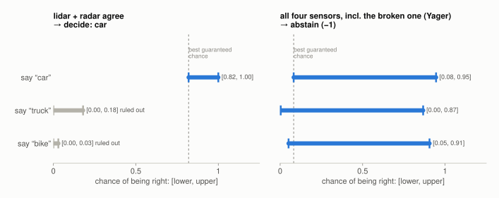
</picture>

Each bar is the chance of being right if you give that answer: **[worst case, best case]**.

- **Left:** "car" is at least 82 % right, and "truck" or "bike" are at most 18 %. Car wins whatever the truth turns out to be, so torchbelief **decides: car**.
- **Right:** after naively fusing in the broken sensor, every answer could be anywhere from about 0 % to 90 % right. No answer is safely better than the others, so torchbelief **abstains** and returns `-1`.

An abstention is not an error. It means "ask a human" or "collect more data", which is often
the most valuable thing a system can say.

```python
from torchbelief import choice

fused = tb.Capacity.from_mass(tb.dempster(lidar.mass(), radar.mass(), F)[0], F)
print(choice.decide_or_abstain(fused, torch.eye(3)))   # tensor(0) → car

shaky, _ = I.fuse_belief(sources, rule="yager")
print(choice.decide_or_abstain(shaky, torch.eye(3)))   # tensor(-1) → abstain
```

`torch.eye(3)` is the utility table: 1 point for naming the right class, 0 otherwise. Use
any `(acts, classes)` matrix to make some mistakes cost more than others.

## 6. Neural networks that say "I don't know"

<picture>
  <source media="(prefers-color-scheme: dark)" srcset="figures/ood-dark.svg">
  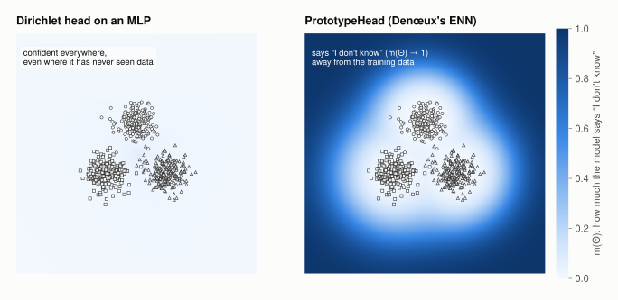
</picture>

Both models were trained on the same three clusters of points. The color shows m(Θ), how
much the model says "I don't know".

- **Left (`EvidentialHead`, a Dirichlet head on a ReLU network):** it is confident everywhere, even in corners it has never seen. ReLU networks extrapolate, so a softmax would behave the same way.
- **Right (`PrototypeHead`, Denœux's evidential network):** evidence comes from *distance to learned prototypes*. Near the data it is confident; far away it smoothly becomes "I don't know".

```python
head = tb.PrototypeHead(in_features=2, frame=F, n_prototypes=12)
x = torch.randn(64, 2)
y = torch.randint(0, 3, (64,))

m = head(x)                                   # (64, 8) valid mass functions
loss = tb.belief_nll(m, y, F)                 # or pignistic_nll, plausibility_nll, hurwicz_nll
loss.backward()
print(tb.vacuity(m, F)[:3])                   # m(Θ) per sample: the "I don't know" score
```

`MassHead` (softmax over chosen subsets) and `EvidentialHead` (Dirichlet / subjective logic)
are also available, and they fit anywhere a classifier head fits.

## 7. Numbers instead of classes: p-boxes

<picture>
  <source media="(prefers-color-scheme: dark)" srcset="figures/pbox-dark.svg">
  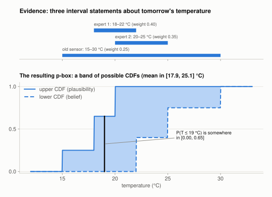
</picture>

Evidence about a *number* often comes as ranges: "18 to 22 °C", "somewhere between 15 and 30".
A `RandomInterval` holds a few weighted ranges. Instead of one cumulative distribution it gives
a **band** of them, a *p-box*. Any probability question gets an interval answer, here
"P(T ≤ 19 °C) is between 0 and 0.65". It is narrow where the evidence is sharp and wide where
it is vague.

```python
from torchbelief.continuous import RandomInterval

ri = RandomInterval(lo=torch.tensor([18., 20., 15.]),
                    hi=torch.tensor([22., 25., 30.]),
                    mass=torch.tensor([0.40, 0.35, 0.25]))
print(ri.mean_bounds())                       # (17.9, 25.1): the mean is somewhere in here
print(ri.prob_bounds(-1e9, 19.))              # (0.00, 0.65)
masses, bins = ri.discretize(torch.tensor([10., 15., 20., 25., 30.]))  # → a class-style frame
```

## 8. Seeing contradictions: Belnap's four values

<picture>
  <source media="(prefers-color-scheme: dark)" srcset="figures/belnap-dark.svg">
  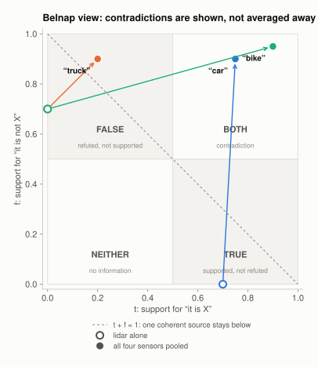
</picture>

Averaging hides disagreement. Belnap's logic keeps it, by asking two separate questions about
every statement such as "it is a car":

- **t:** how strongly does *someone* support it?
- **f:** how strongly does *someone* refute it?

That gives four outcomes: **TRUE**, **FALSE**, **NEITHER** (nobody knows) and **BOTH** (sources
contradict each other). The lidar alone has "car" as TRUE (hollow dot). Once all four sensors
are pooled, "car" and "bike" both move to BOTH, which flags precisely what needs a closer look.

```python
from torchbelief import belnap

x = belnap.pool(sources)                       # (3 classes, 2) = (t, f) for each class
print([belnap.LABELS[i] for i in belnap.label(x)])   # ['both', 'false', 'both']
print(belnap.contradiction(x))                 # how much t + f overshoots 1
```

## 9. Real video: labels that don't flicker

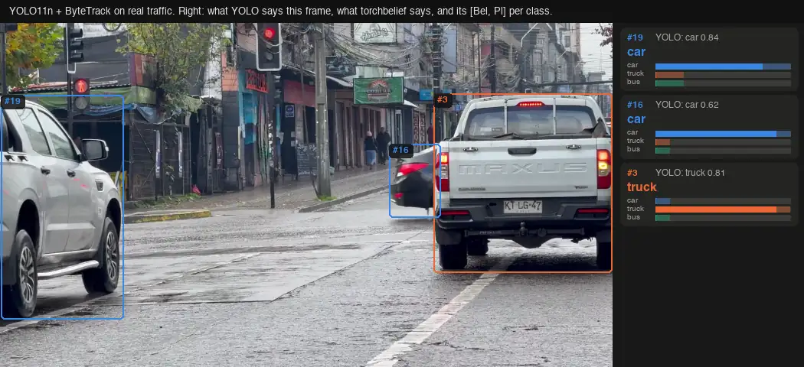

Run a detector with a tracker on real traffic and watch the labels. YOLO decides every frame
from scratch, so a hatchback seen from behind is "car" for a second, "truck" for the next
two thirds of a second, then "car" again. The tracker keeps the box steady, but the label you
see is whatever the latest frame said, with a confident-looking score attached.

torchbelief adds one belief function per track and two lines per frame:

```python
import torch, torchbelief as tb
from torchbelief import choice

F = tb.Frame(3, names=["car", "truck", "bus"])
stream = [("car", 0.62)] * 60 + [("truck", 0.55)] * 20 + [("car", 0.60)] * 30   # one track, 30 fps

m = tb.vacuous(F)
for cls, conf in stream:
    m = tb.discount(m, 0.99, F)                                  # stale evidence fades
    det = tb.simple_support(F, F.subset([cls]), 0.1 * conf)       # one frame ≈ a tenth of a look
    m, _ = tb.dubois_prade(m, det, F)                            # disagreement → "car or truck"

keep = choice.maximal_acts(tb.Capacity.from_mass(m, F), torch.eye(3))   # classes nobody beats
```

- **`0.1 · conf`**: consecutive frames of one network are not independent witnesses. Twenty
  frames that agree are worth about two independent looks, not twenty.
- **Dubois–Prade** moves the mass that two frames dispute to the union of what they said. When
  the detector alternates, the track ends up believing "car or truck", which is exactly what
  the evidence supports.
- **`maximal_acts`** gives the label: the set of classes that no other class beats. After the
  stream above it reads `car` after the first two seconds, `car | truck` during the run of
  "truck" frames, and `car` again at the end.

<picture>
  <source media="(prefers-color-scheme: dark)" srcset="figures/tracking-dark.svg">
  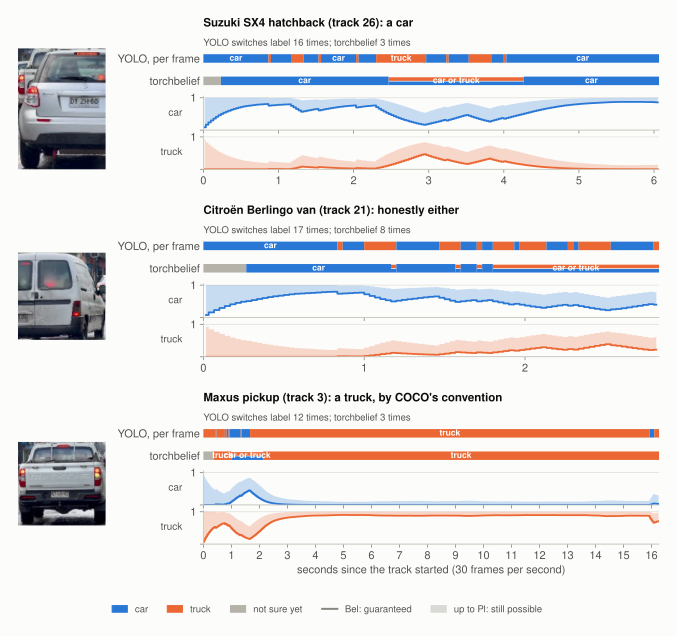
</picture>

Three tracks from the clip, replayed from the saved detection log:

- **Hatchback (a car).** YOLO calls it "truck" in 39 of 182 frames. torchbelief never names
  the wrong class: it says "car or truck" while the "truck" frames keep coming, then returns
  to "car".
- **Van.** COCO's own annotators would disagree about this one. YOLO flips 17 times in under
  three seconds; torchbelief settles on "car or truck", which is the honest answer.
- **Pickup (a truck in COCO's convention).** YOLO calls it "car" for a stretch early on. The
  belief hedges to "car or truck" there, then holds "truck" for the rest of the 16-second track.

Over all 15 tracks longer than a second, YOLO changes label 74 times and torchbelief 20 times,
not counting the one-time "not sure yet" at the start of each track.

**What it doesn't do.** It needs about a quarter of a second of evidence before naming
anything. It can't fix the tracker: at 20.5 s ByteTrack hands the van's id to the pickup
cutting in, and the track inherits the van's history. The `0.99` and `0.1` suit 30 fps
video; at a lower frame rate, use a smaller forgetting factor and a larger weight.

```bash
pip install ultralytics                   # optional detector (AGPL-3.0); torchbelief doesn't need it
python examples/tracking.py your.mp4 --out tracked.mp4     # annotated video like the one above
python examples/tracking.py --replay docs/data/osorno-yolo11n.json   # belief layer only, no YOLO
```

The clip is [*Rainy City Traffic at Osorno Intersection*](https://www.pexels.com/video/32069050/)
by Videas Cl on Pexels (Pexels license). [`make_tracking_demo.py`](make_tracking_demo.py)
regenerates the detection log, the animation and the thumbnails from it.

## 10. Trusting a source only so far

<picture>
  <source media="(prefers-color-scheme: dark)" srcset="figures/corrections-dark.svg">
  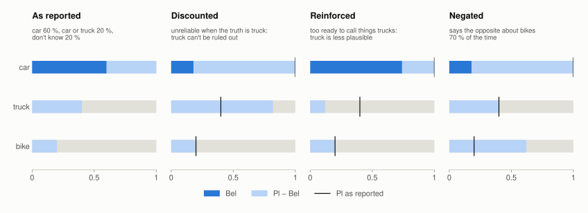
</picture>

Discounting (section 4) trusts a source less *everywhere*. Real sources fail in specific
ways: a camera that mistakes trucks for cars at night, a classifier that calls too many things
trucks, a sensor that reports one class back to front. `torchbelief.corrections` has a
correction for each, with one degree β per class, where 1 leaves the source alone:

| Correction | With probability 1 − β, the source… | What happens to that class |
|---|---|---|
| `contextual_discount` | is unreliable when the truth is this class | it can't be ruled out |
| `contextual_reinforce` | over-reports this class | it becomes less plausible |
| `contextual_negate` | says the opposite about this class | support and refutation swap |

```python
F = tb.Frame(3, names=["car", "truck", "bike"])       # section 1's frame again (section 9 changed it)
m = torch.zeros(F.size, dtype=torch.float64)          # the source in the picture
m[F.subset(["car"])], m[F.subset(["car", "truck"])], m[F.theta] = 0.6, 0.2, 0.2
weak_on_trucks = torch.tensor([1.0, 0.3, 1.0], dtype=torch.float64)

tb.interval(tb.contextual_discount(m, weak_on_trucks, F), F)    # Pl(truck): 0.4 → 0.82
tb.interval(tb.contextual_reinforce(m, weak_on_trucks, F), F)   # Pl(truck): 0.4 → 0.12
```

You rarely know β in advance. Learn it from a small labelled calibration set: `fit_contextual`
solves for it in closed form, and `ContextualCorrection` is an `nn.Module`, so the correction
can also be trained by gradient descent, on its own or inside a bigger model.

```python
y_cal = torch.randint(0, 3, (300,))                                    # true classes
said = torch.where((y_cal == 1) & (torch.rand(300) < 0.5), 0, y_cal)   # half the trucks are called "car"
m_cal = torch.zeros(300, F.size)
m_cal[torch.arange(300), 1 << said] = 0.9                              # 90 % sure of what it says
m_cal[:, F.theta] = 0.1

print(tb.fit_contextual(m_cal, y_cal, F))       # ≈ [[1.00, 0.85, 1.00]]: only trucks are a problem
corr = tb.ContextualCorrection(F, "discount", init=tb.fit_contextual(m_cal, y_cal, F))
opt = torch.optim.Adam(corr.parameters(), lr=0.05)
for _ in range(200):
    loss = tb.pl_loss(corr(m_cal), y_cal, F)    # Denœux's E_pl: squared error of Pl per class
    opt.zero_grad(); loss.backward(); opt.step()
```

A corrected source is better *calibrated*: "truck" stays plausible whenever it says "car".
It does not necessarily *answer* differently, because "car" is still the most likely class
there. For that, see the next section.

## 11. Answering with a set

Sometimes the honest answer is "car or truck". A set prediction is a bool mask with one entry
per class, and the usual score is **u65** or **u80**: 1 for the right single class, 0.65
(or 0.80) for a pair that contains the truth, and 0 if the truth is missing. Naming a pair
then scores more than flipping a coin between its two classes, which would average 0.5.

There are two ways to get sets:

- **From any mass**, `strong_dominance(m, F)` keeps each class that no other class beats
  (Bel of a rival above its Pl). This is cautious, and it only widens the answer when the
  intervals really overlap.
- **By training for it**, `expected_utility_loss(m, y, F, a, b)` teaches a head to put its mass
  on the set that maximises the expected u65 or u80, and `max_mass_set(m, F)` reads that set off.

```python
from torchbelief import metrics

sets = tb.strong_dominance(m_cal, F)                      # bool (300, 3)
print(metrics.u65(sets, y_cal), metrics.u80(sets, y_cal))   # ≈ 0.81, 0.81: always one class

head = tb.MassHead(F.size, F, focal="all")                # reads the source's mass, one output per subset
opt = torch.optim.Adam(head.parameters(), lr=0.05)
for _ in range(300):
    loss = tb.expected_utility_loss(head(m_cal), y_cal, F, a=2.2, b=1.2)   # train for u80
    opt.zero_grad(); loss.backward(); opt.step()
sets = tb.max_mass_set(head(m_cal), F)
print(metrics.u80(sets, y_cal))                           # ≈ 0.87: answers {car, truck} when told "car"
```

When the source says "car", one time in three it is really a truck, so under u80 "car or
truck" (0.80) beats "car" (about 0.67 on average), and the head learns exactly that.
[`examples/learned_correction.py`](../examples/learned_correction.py) runs the whole story on
an EkNN classifier after a deployment shift:

| | E_pl ↓ | u65 | u80 | classes per answer |
|---|---|---|---|---|
| classifier as is | 0.405 | 0.797 | 0.797 | 1.00 |
| with learned contextual discounting | 0.359 | 0.797 | 0.797 | 1.00 |
| with a head trained for u80 | 0.538 | 0.811 | 0.891 | 1.53 |

Discounting improves calibration (lower E_pl) without changing a single answer. The u80 head
gives up some calibration to answer better.

---

## Glossary

| Term | Meaning |
|---|---|
| **frame** Θ | the list of possible answers (`tb.Frame`) |
| **mass** m | one number per *subset* of answers, summing to 1 |
| **Bel / Pl** | lower / upper probability: support you can count on / support that's still possible |
| **vacuous** | m(Θ) = 1: "I know nothing" |
| **capacity** | the general lower-probability object everything converts to (`tb.Capacity`) |
| **pignistic** | the best single probability squeezed out of an interval, for when you must bet |
| **conflict** κ | mass that ends up on ∅ when combining: how much the sources contradict |
| **discounting** | trusting a source less: move part of its mass to "don't know" |
| **correction** | discounting, reinforcement or negating, with a degree β per class |
| **u65 / u80** | scores for set answers: a correct pair is worth 0.65 / 0.80, a correct single class 1 |
| **credal set** | the set of all probabilities between Bel and Pl |
| **abstain** | refuse to pick when no answer is better in every plausible scenario |

Want the math behind all this? The [README](../README.md) lists every function and the papers
it implements.
